
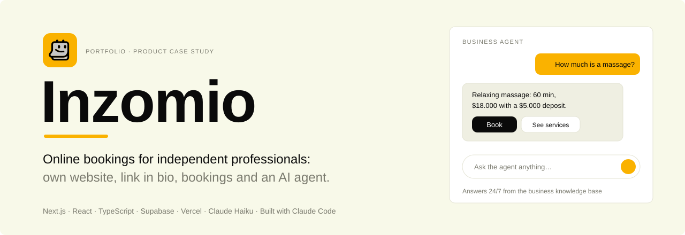

  
  
  
  
  
  

# Inzomio

> Online bookings for independent professionals: own website, a link in bio, bookings that confirm themselves and an AI agent that answers clients 24/7.

This repository is a **portfolio showcase**. It tells the story, the product and the architecture of Inzomio. The source code and database live in a private repository: there's no business logic, credentials or schemas here.

| | |
|---|---|
| **Problem** | Nutritionists, psychologists, physiotherapists, beauty and wellness professionals coordinate bookings by message, one by one. |
| **Solution** | Every business gets its own page, an agenda that confirms bookings on its own, a management panel and an AI agent. |
| **Business model** | Free $0 · Profesional $14.900 · Empresas $24.900 per month (ARS). 15-day trial, no fee per booking. |
| **Build** | Started as a weekend experiment with Claude Code; today a product in production. |
| **Status** | In production at [inzomio.app](https://inzomio.app). Public launch on Instagram, LinkedIn and YouTube in September 2026. |

**Contents:** [Demo](#see-it-in-90-seconds) · [Product](#the-product) · [AI agent](#the-ai-agent) · [Screens](#real-screens) · [Plans](#plans) · [Channels](#communication-channels) · [Architecture](#architecture) · [Origin](#origin-and-method) · [Roadmap](#roadmap)

---

## See it in 90 seconds

  

<b><a href="https://youtu.be/acQ1y2dnfbo">▶ Inzomio: online bookings for independent professionals · full demo</a></b>

## The product

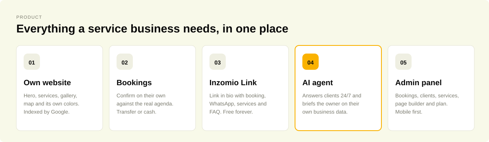

One codebase serves four surfaces:

| Surface | For | What it does |
|---|---|---|
| Marketing site | Prospects | Problem, how it works, real pricing and sign-up |
| Business page | Each business's clients | Its own website (paid plans) or Inzomio Link (Free), with booking and the agent |
| Business panel | The business owner | Bookings, clients, services, page builder, agent, subscription |
| Platform panel | The Inzomio team | Plans, features per plan, agent engine and support |

Bookings are validated on the server, not only on screen, and the public pages are protected against bots and abuse.

## The AI agent

The agent is the core differentiator. There are **two**, each with its own job.

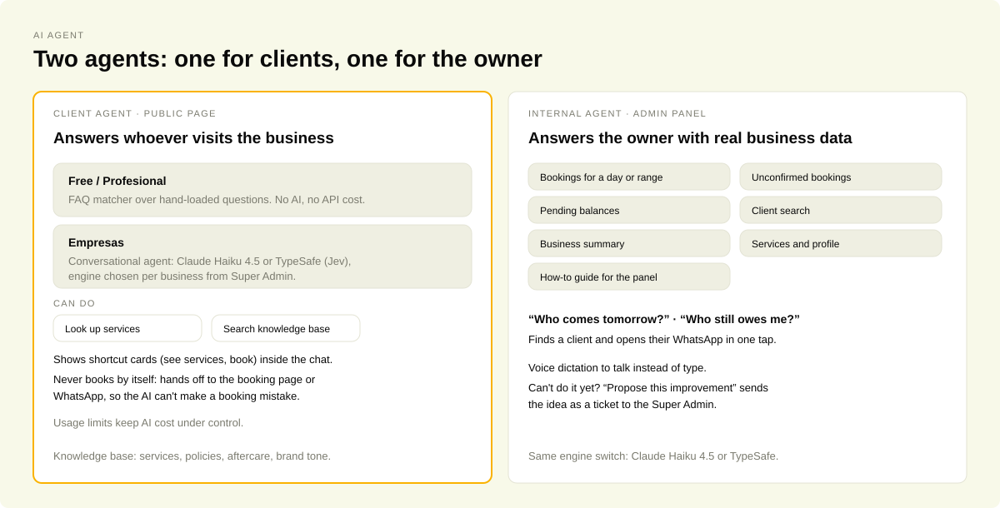

**Client agent: on every public page.** It answers what a visitor asks about services (price, duration, deposit), policies and aftercare, searching the knowledge base the business loaded. In the chat it shows shortcut cards (see services, book).
- It **doesn't book by itself**: when someone wants to book, change or cancel, it hands off to the booking page or the business's WhatsApp. It's a design decision so the AI can't make booking mistakes.
- **Free / Profesional:** a matcher over hand-loaded FAQs, with no AI and no API cost.
- **Empresas:** a real conversational agent running Claude Haiku 4.5, or TypeSafe (Jev), chosen per business from the platform panel.
- Usage limits keep AI cost under control.

**Internal agent: inside the admin panel.** It answers the owner about their own business with real data: bookings for a day or a range, unconfirmed bookings, pending balances, client search (with a direct WhatsApp link), a general summary, services and profile.
- **Voice dictation** to talk instead of type.
- When it can't do something yet, **"Propose this improvement"** sends the idea as a ticket to the Inzomio team. The product learns from its own users.

<table>
  <tr>
    <td width="33%">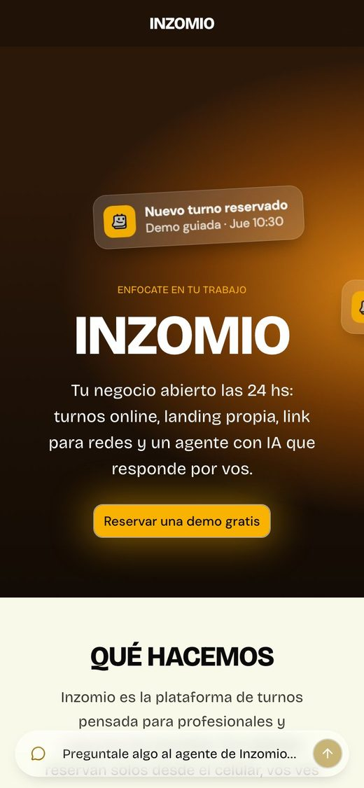</td>
    <td width="33%">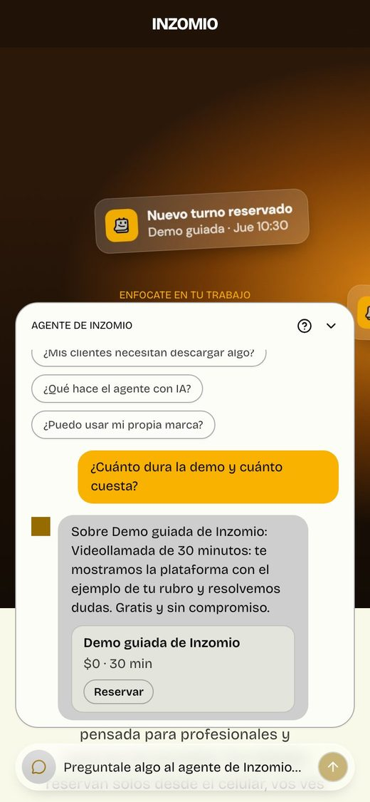</td>
    <td width="33%">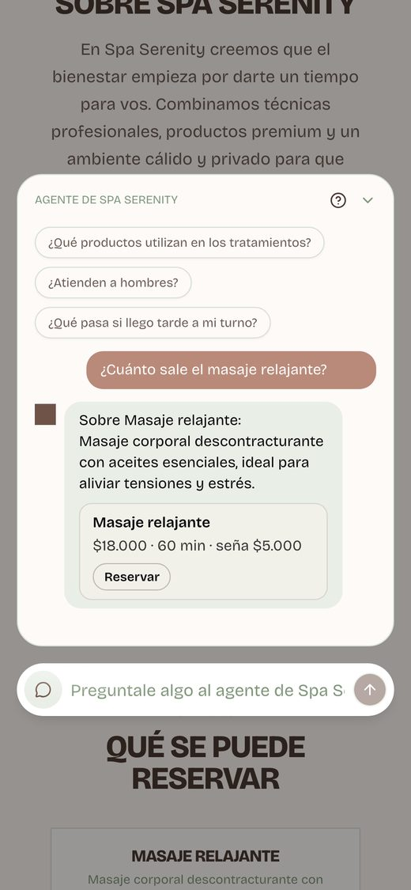</td>
  </tr>
  <tr>
    <td align="center">Suggested questions</td>
    <td align="center">Answer with a booking shortcut</td>
    <td align="center">Same agent on a client's business</td>
  </tr>
</table>

## Real screens

### Marketing site and pricing · `inzomio.app`

<table>
  <tr>
    <td width="50%">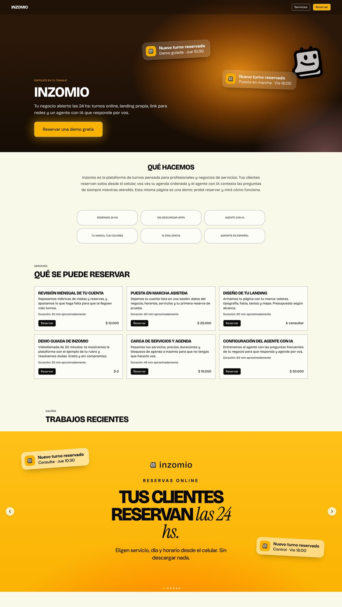</td>
    <td width="50%">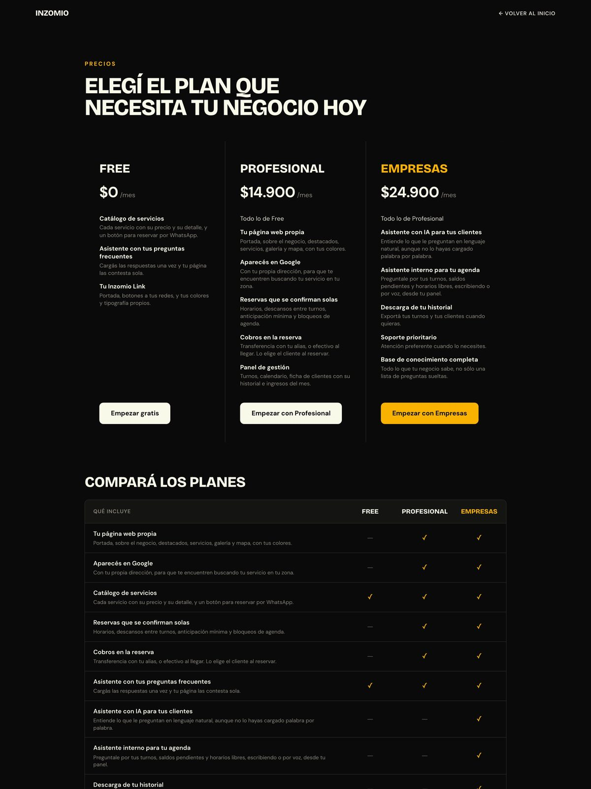</td>
  </tr>
</table>

### Subscriber website · demo business "Spa Serenity"

Each business gets its own page with its own colors, services, gallery and map. This is the demo business on desktop:

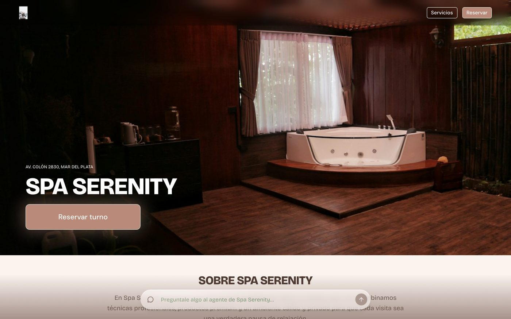

<table>
  <tr>
    <td width="50%">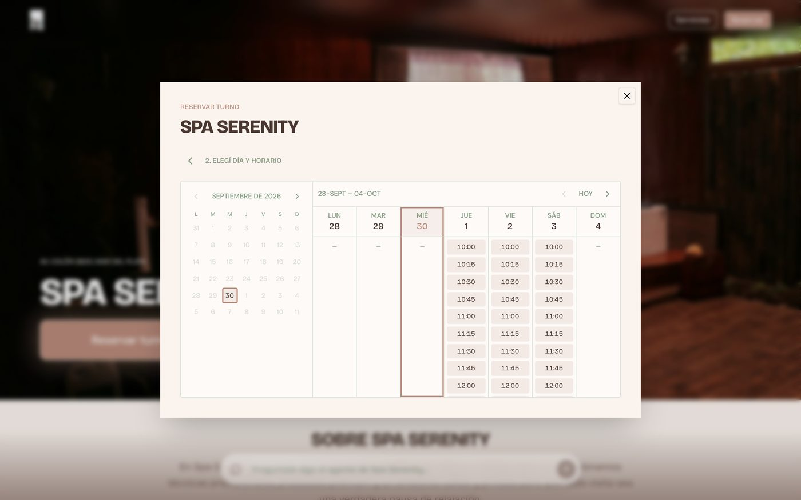</td>
    <td width="50%">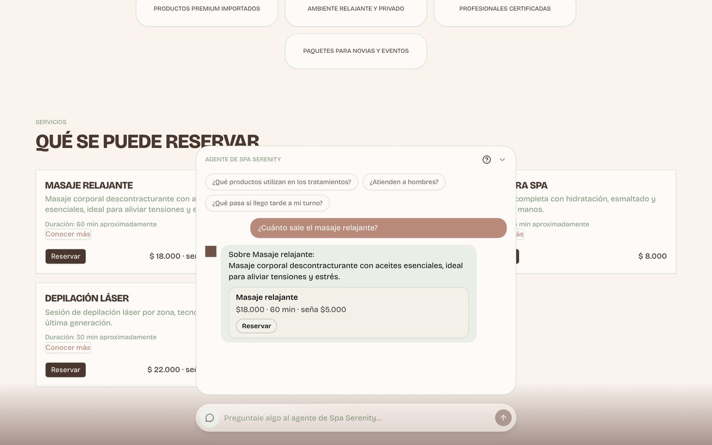</td>
  </tr>
  <tr>
    <td align="center">Booking: real availability against the agenda</td>
    <td align="center">The business agent on desktop</td>
  </tr>
</table>

### Mobile first: booking flow and Inzomio Link

<table>
  <tr>
    <td width="20%">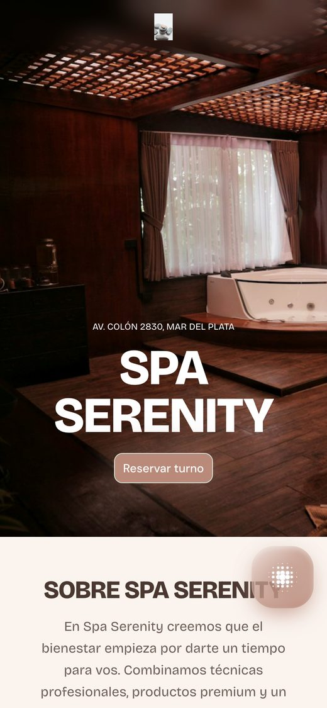</td>
    <td width="20%">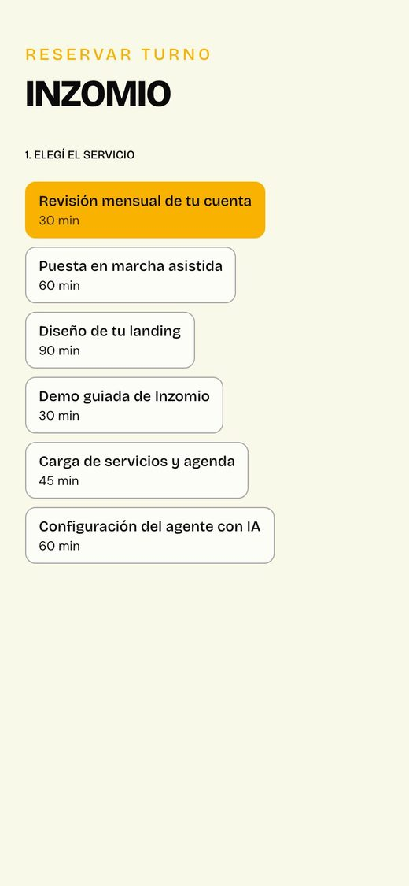</td>
    <td width="20%">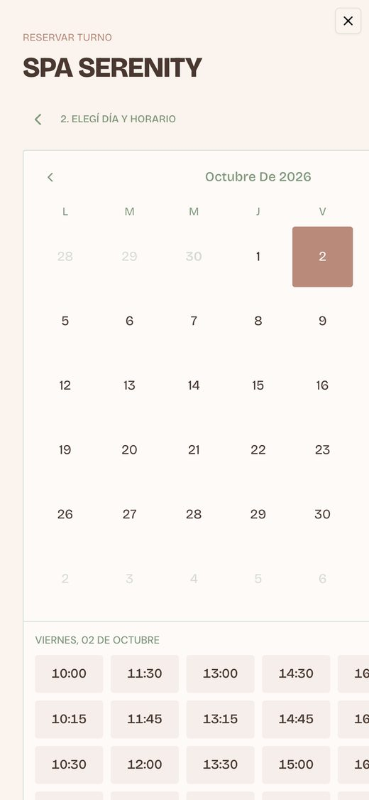</td>
    <td width="20%">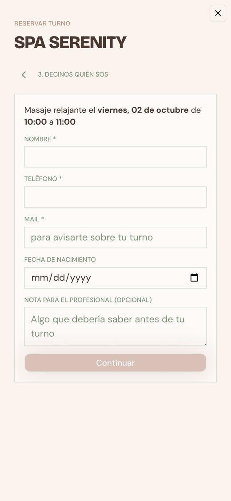</td>
    <td width="20%">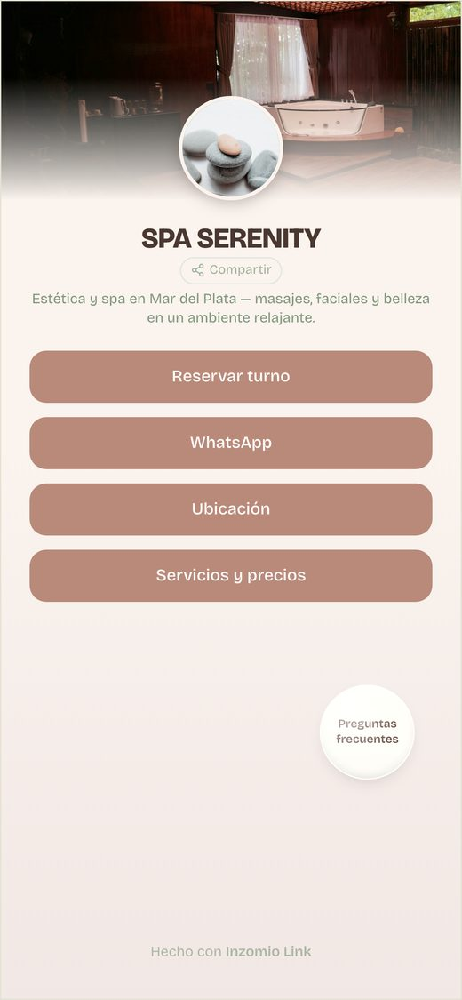</td>
  </tr>
  <tr>
    <td align="center">Business page</td>
    <td align="center">1 · Service</td>
    <td align="center">2 · Day and time</td>
    <td align="center">3 · Details</td>
    <td align="center">Inzomio Link</td>
  </tr>
</table>

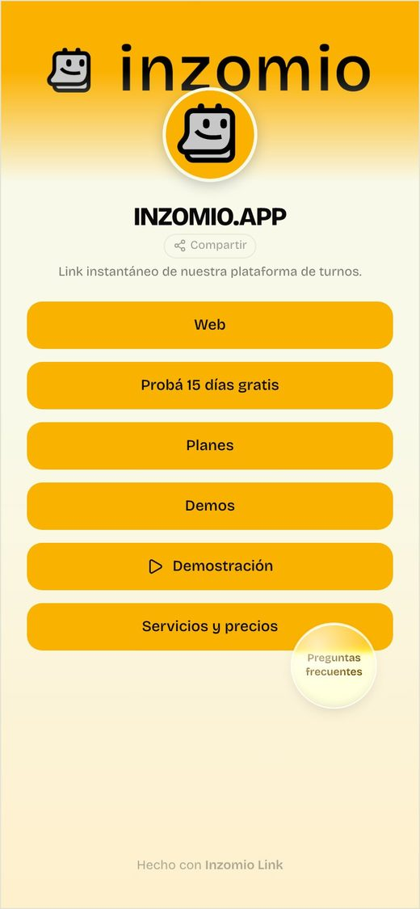 Inzomio's own link in bio, built with Inzomio Link

### Admin panel

Home with KPIs (bookings, clients, revenue, services) and today's bookings, calendar and bookings table, services, clients with history, Inzomio Link editor, visual page builder with live preview, agent setup and subscription. Everything works on mobile.

> 📸 Admin panel screenshots: pending. They're added once they're captured from a demo account.

## Plans

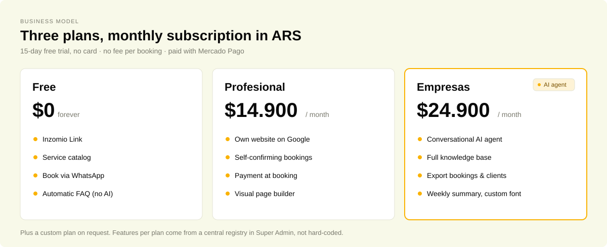

Plans and features aren't hard-coded: a central registry in the platform panel decides, feature by feature, which plan includes it, with per-business exceptions. If a trial ends without a paid plan, the account moves to Free automatically: the page and data stay.

## Communication channels

| Channel | Use |
|---|---|
| [inzomio.app](https://inzomio.app) | Marketing site, pricing and sign-up |
| [Instagram · @inzomio.app](https://www.instagram.com/inzomio.app/) | Posts, carousels, reels and stories for professionals |
| [LinkedIn](https://www.linkedin.com/company/145218836/) | Company page, B2B and partnerships |
| [YouTube · @Inzomio-app](https://www.youtube.com/@Inzomio-app) | Full demo and step-by-step tutorials |
| Email · inzomio.app@gmail.com | Support and contact |

### YouTube: "Your first steps in Inzomio"

A tutorial series so each business can set up its account alone. Thumbnails made with the brand generator:

<table>
  <tr>
    <td>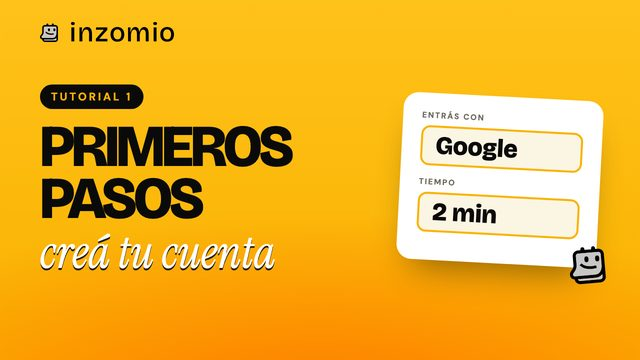</td>
    <td>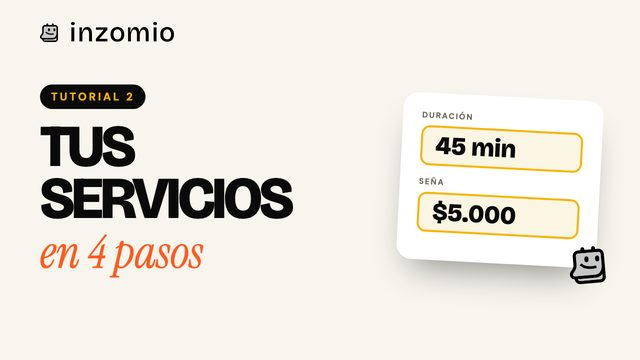</td>
    <td>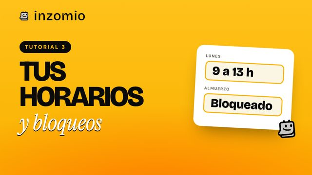</td>
  </tr>
  <tr>
    <td>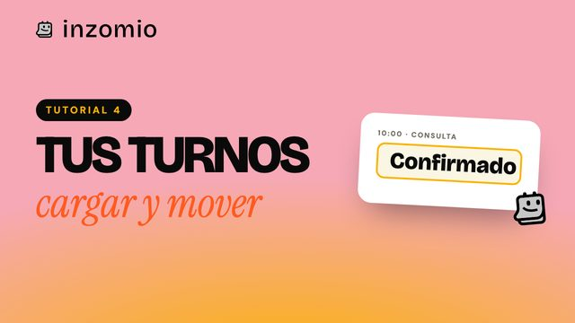</td>
    <td></td>
    <td>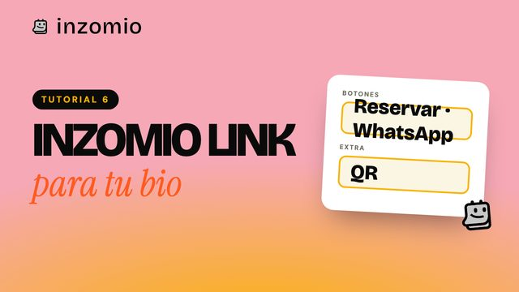</td>
  </tr>
  <tr>
    <td></td>
    <td>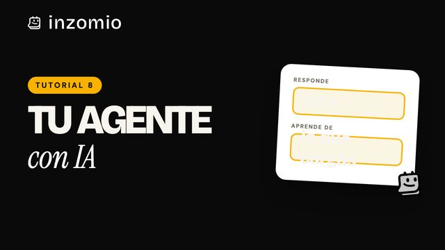</td>
    <td>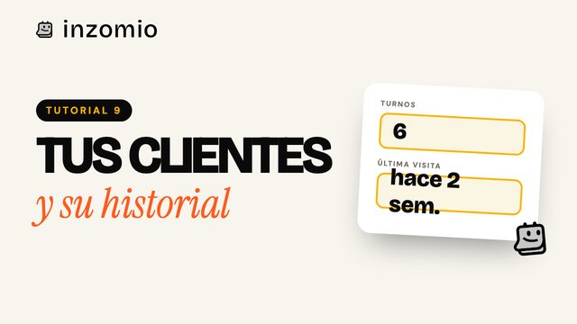</td>
  </tr>
  <tr>
    <td>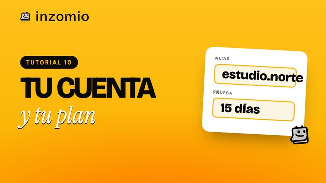</td>
    <td>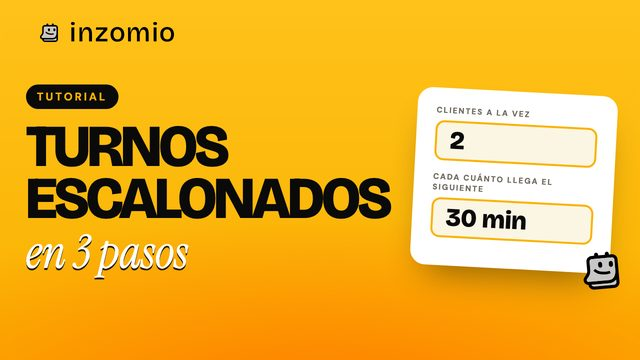</td>
    <td></td>
  </tr>
</table>

## Architecture

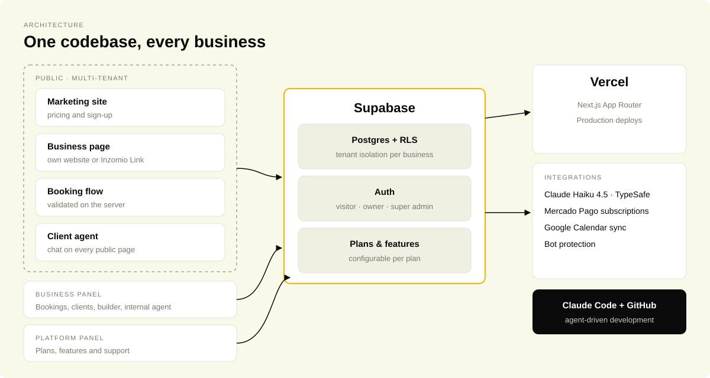

- **Real multi-tenancy:** every business has its own page and booking flow, isolated with Row Level Security in Supabase. One codebase serves all of them.
- **Three permission levels:** visitor, business owner and platform team.
- **Built-in page builder:** editing the landing page lives inside the product, with live preview.
- **Payments:** subscriptions charged with Mercado Pago. Clients pay the business by transfer or cash, with no fee per booking.

**Stack:** Next.js (App Router) · React · TypeScript · Supabase (Postgres, Auth, RLS) · Vercel · Claude Haiku 4.5 and TypeSafe for the agents · Mercado Pago · Google Calendar · bot protection.

## Origin and method

Inzomio started as an experiment: how far could a real product go working side by side with an AI agent (Claude Code), without writing code by hand. The working name was *Insomnio*, literally, because it started on a Friday at dawn and ran through a whole weekend of conversation with the agent. The brand later became **Inzomio**.

It was also a test of **method**: whether a product management process could hold a build at that speed. It started as an MVP and grew, with the same loop at every stage, into the product in production it is today:

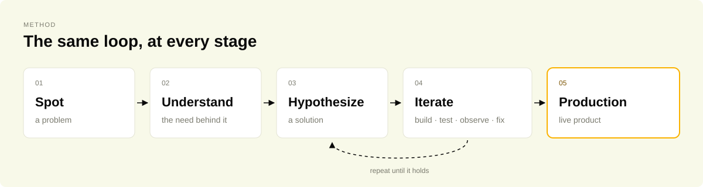

## Roadmap

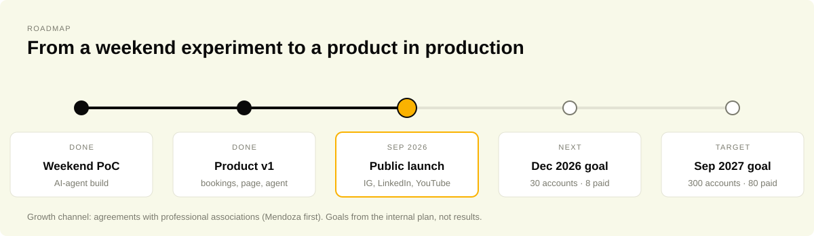

The main growth channel is agreements with professional associations (Mendoza first), with direct outreach, creators and an affiliate program as support. Next on the product: multiple agendas or professionals per business and card or Mercado Pago payments at booking.

---

  <a href="https://inzomio.app"><b>inzomio.app</b></a> ·
  <a href="https://youtu.be/acQ1y2dnfbo">Demo</a> ·
  <a href="https://www.youtube.com/@Inzomio-app">YouTube</a> ·
  <a href="https://www.instagram.com/inzomio.app/">Instagram</a> ·
  <a href="https://www.linkedin.com/company/145218836/">LinkedIn</a>

Built by Jonathan Godoy · <a href="https://jonathangodoy.xyz/en"><b>jonathangodoy.xyz</b></a>

